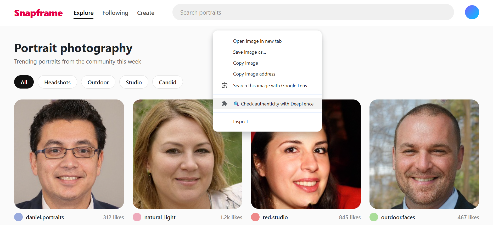
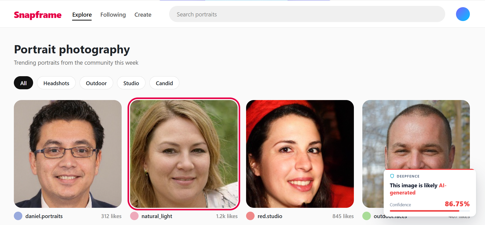
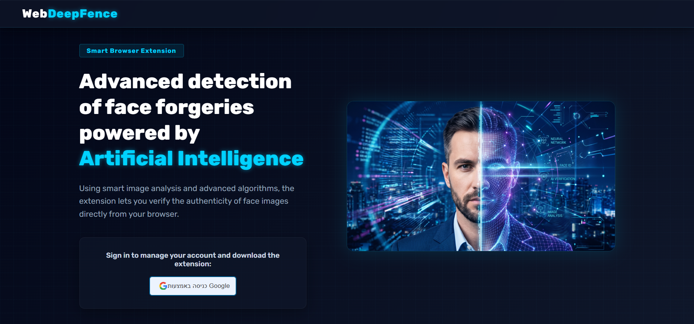
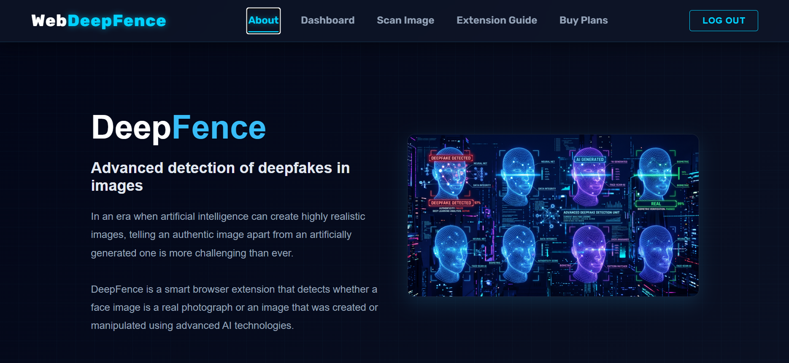
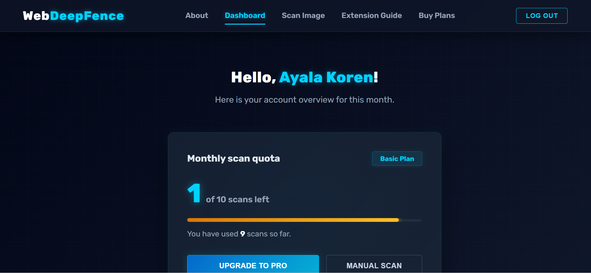
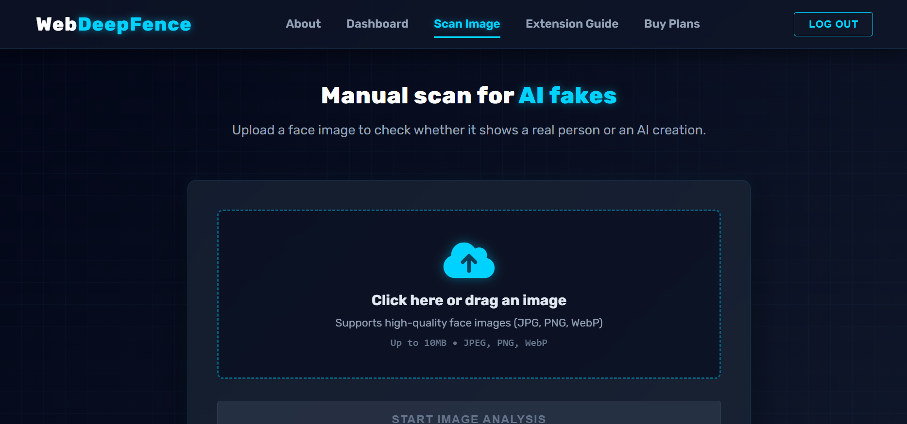
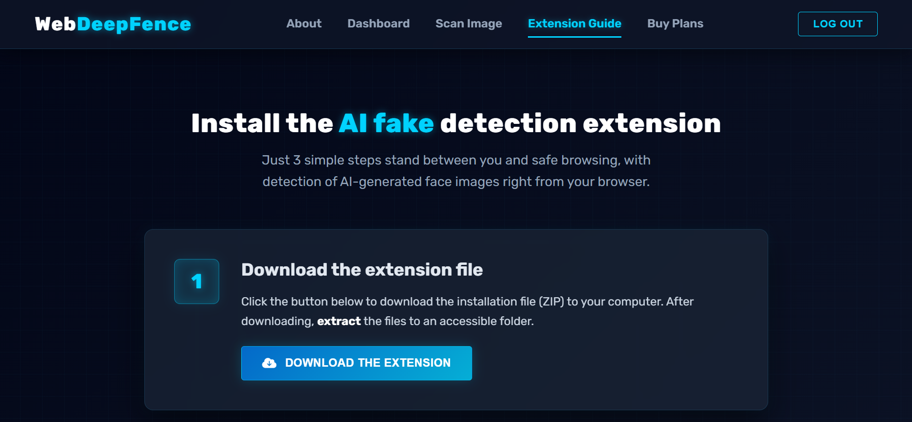
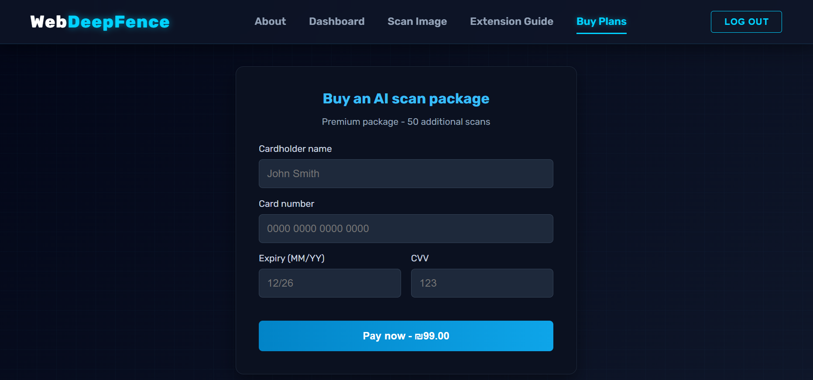

# DeepFence – AI Deepfake Face Detection

DeepFence detects whether a face image is a real photograph or AI-generated / manipulated.
It combines **three deep-learning models** in a weighted ensemble and is available both as a
**web app** and as a **Chrome extension** that scans any image on the web with a right-click.

> Final project – Software Engineering, by Ayala Koren.

## Screenshots

### Chrome extension
| Right-click any image | Result for an AI-generated face |
|---|---|
|  |  |

*The result shown is the real model output for this image (Fake, 86.75% confidence). The gallery page is a local demo page.*

### Web app
| Home | About |
|---|---|
|  |  |

| Dashboard | Manual scan |
|---|---|
|  |  |

| Extension guide | Buy plans |
|---|---|
|  |  |

## Features

- **Ensemble of 3 models** – EfficientNet-B4 (TensorFlow), Vision Transformer ViT-B/16 (PyTorch) and a frequency-domain (DCT) EfficientNet-B0 (PyTorch), run in parallel.
- **Face-focused analysis** – MTCNN detects and crops the face before analysis; images without a face are rejected.
- **Quality-aware weighting** – heavily compressed images (e.g. sent over WhatsApp) lose the high-frequency details the DCT model relies on, so its weight is dropped to 0% automatically to avoid false positives.
- **Metadata fast path** – images whose metadata contains a known AI-generator signature (Midjourney, DALL·E, Stable Diffusion…) are flagged without running the models.
- **Chrome extension** – right-click any image → *"Check authenticity with DeepFence"*.
- **User accounts & quotas** – Google sign-in, Free plan (10 scans/month) and Pro plan (100 scans/month), stored in MongoDB.

## Architecture

```
 ┌──────────────────┐     ┌───────────────────┐
 │ Angular web app  │     │ Chrome extension  │
 │  (frontend-web)  │     │(browser-extension)│
 └────────┬─────────┘     └─────────┬─────────┘
          │        HTTPS / HTTP     │
          └────────────┬────────────┘
                       ▼
          ┌──────────────────────────┐      ┌──────────┐
          │  ASP.NET Core Web API    │◄────►│ MongoDB  │
          │  (backend-api)           │      │ (users)  │
          │  users, quota, metadata  │      └──────────┘
          └────────────┬─────────────┘
                       ▼
          ┌──────────────────────────┐
          │  Flask AI engine         │
          │  (ai-engine)             │
          │  MTCNN → 3 models →      │
          │  weighted ensemble       │
          └──────────────────────────┘
```

### How a scan works

1. The user uploads an image (web app) or right-clicks it (extension).
2. The C# API checks the user's monthly quota, then scans the image metadata for AI-generator signatures.
3. Otherwise the image is forwarded to the Flask AI engine, which crops the face with MTCNN and runs the three models in parallel.
4. Each model's output is normalized to a 0–100 "fake probability" and combined:
   - High-quality image: EfficientNet 36% · ViT 36% · DCT 28%
   - Compressed / low-quality image: EfficientNet 50% · ViT 50% · DCT 0%
5. The final decision (Real / Fake + confidence) and a per-model breakdown are returned. A scan is charged only if the analysis succeeded.

## Models

All models were trained in Google Colab on a balanced dataset of real and StyleGAN-generated faces (see [`training/`](training)).

| Model | Framework | Input | Result |
|---|---|---|---|
| EfficientNet-B4 | TensorFlow / Keras | RGB 380×380 | ~99.6% validation accuracy |
| ViT-B/16 (fine-tuned) | PyTorch | RGB 224×224 | ~100% accuracy on a 20,000-image test set |
| EfficientNet-B0 on DCT | PyTorch | log-DCT of grayscale 224×224 | ~80.6% validation accuracy |

> These results are on images from the same distribution as the training data. Real-world images
> (other generators, heavy compression, filters) are harder – which is why the project combines
> models that look at different signals (textures, global structure, frequency artifacts).

## Tech stack

| Part | Technologies |
|---|---|
| AI engine | Python, Flask, TensorFlow/Keras, PyTorch, torchvision, MTCNN, OpenCV |
| Backend API | C#, ASP.NET Core (.NET 10), MongoDB Driver, MetadataExtractor |
| Web app | Angular 21, TypeScript, Google Identity Services |
| Extension | Chrome Extension Manifest V3, JavaScript |
| Training | Google Colab, Jupyter notebooks |

## Project structure

```
ai-engine/          Flask server – face detection + 3-model ensemble (port 5000)
backend-api/        ASP.NET Core Web API – users, quota, metadata check (ports 7058 / 5046)
frontend-web/       Angular web app (port 4200)
browser-extension/  Chrome extension (right-click scan)
training/           Colab notebooks used to train the three models
```

## Running locally

### Prerequisites
- Python 3, .NET 10 SDK, Node.js (LTS) and npm
- MongoDB running on `mongodb://127.0.0.1:27017`
- Google Chrome (for the extension)

### 1. Model weights
The trained weights are too large for GitHub. Download them from **[Google Drive](https://drive.google.com/drive/folders/1nK3aA7RgmcsV0ZvlflbFykSVhA5-yKq1?usp=drive_link)** and place them in `ai-engine/`:

```
EfficientNet_B4_model.keras
best_vit_fake_detection.pth
best_dct_model_final.pth
```

### 2. AI engine (Flask)
```bash
cd ai-engine
python -m venv venv
venv\Scripts\activate          # on macOS/Linux: source venv/bin/activate
pip install -r requirements.txt
python app.py                  # http://127.0.0.1:5000
```

### 3. Backend API (ASP.NET Core)
```bash
cd backend-api/server_user
dotnet dev-certs https --trust   # first time only
dotnet run --launch-profile https   # https://localhost:7058 and http://localhost:5046
```

### 4. Web app (Angular)
```bash
cd frontend-web
npm install
npm start                      # http://localhost:4200
```

### 5. Chrome extension
1. Open `chrome://extensions` and enable **Developer mode**.
2. Click **Load unpacked** and select the `browser-extension` folder.
3. Log in on the web app (http://localhost:4200) – the extension picks up your account automatically.
4. Right-click any face image → **Check authenticity with DeepFence**.

## Known limitations

This is an academic project, built to run locally. Before a real deployment it would need:
- **Server-side authentication** – the API currently trusts the email sent by the client; the Google ID token should be verified on the server.
- **Real payments** – the payment page is a simulation (no payment provider).
- **Configuration** – service URLs and ports are hard-coded for `localhost`.
- **Generalization** – the models were trained on one dataset (StyleGAN faces) and may be less accurate on images from newer generators.
